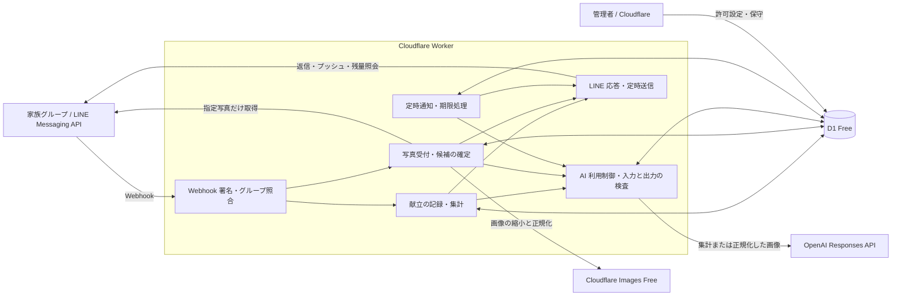

# LINE 晩ごはん Bot 基本設計書

> Cloudflare Workers と D1 を使い、承認した家族グループの献立を記録する。OpenAI Responses API は献立提案と指定写真の認識に使い、両方を個別に停止できる。写真は処理中だけ扱い、本人が確定した料理名を履歴へ登録する。定時通知は初期状態で無効とし、残量を確認できる場合だけ送る。

## 文書管理（必須）

| 記録項目 | 内容 |
| --- | --- |
| 文書版または更新日 | v1.0 · 2026-11-22 JST |
| 作成・更新者（該当時） | Codex |
| 関連資料・版の参照先（該当時） | [要件定義書 v1.1](requirements.md)・[調査報告書 v1.1](investigation.md)・ローカルの課題管理表 Q-001 |

## 設計対象と前提（必須）

| 記録項目 | 内容 |
| --- | --- |
| 対象機能・システム | 一家族・1グループの本番 Bot。テキストと写真による記録、履歴・傾向、翌日の提案、定時通知、管理と復旧。 |
| 設計目的 | LINE の操作から献立の保存・分析・返信までを分け、外部サービス停止・残量不足・同時投稿時の振る舞いを決める。 |
| 設計範囲 | コンポーネント、外部・内部の契約、状態遷移、データ管理、費用と運用。契約 IF-01〜IF-14 を結合試験で参照する。 |
| 設計対象外（該当時） | クラスや SQL の実装仕様、アカウントの作成・有料化、実環境への配備、試験の実行、専用画面。 |
| 要件定義書の版・参照先 | [要件定義書 v1.1](requirements.md) FR-01〜FR-07、NFR-01〜NFR-05、AC-01〜AC-20。 |
| 現行構成の参照先（該当時） | 新規開発。既存の Bot・DB・配備設定はプロジェクト内に見当たらない。LINE の過去投稿の自動移行は行わない。 |
| システムの利用環境・外部依存（該当時） | 日本時間の LINE グループ、LINE Messaging API、Cloudflare Workers Free・D1 Free、写真縮小用の Cloudflare Images Free、OpenAI Platform プロジェクト API キー。 |
| 設計の前提・制約（該当時） | 家族が外部処理の説明を受け、管理者が承認したグループで利用する。無料枠の確認が済むまでは AI・写真・定時通知を無効。テストと本番は別接続・別データとする。 |

## 要件との対応（必須）

| 要件 ID・項目名 | 対応する構成要素 | 契約 ID・項目名（該当時） | 設計で実現する振る舞い | 要件の参照先 |
| --- | --- | --- | --- | --- |
| FR-01 家族グループ | Webhook | IF-01 Webhook 受信 | 署名と登録済みグループを照合して操作を受理。 | [AC-01](requirements.md#受け入れ条件本番必須) |
| FR-01 家族グループ | 管理 | IF-13 管理者操作 | グループを明示承認し、メンバー変更後は再承認まで停止。 | AC-01・AC-02 |
| FR-02 日々の記録 | 操作処理・D1 | IF-02 献立の変更 | 日付ごとに1件、登録済みの日は訂正を案内。 | AC-03・AC-04 |
| FR-02 日々の記録 | LINE 送信 | IF-10 応答送信 | 保存結果を承認済みグループに返信。 | AC-03 |
| FR-03 訂正・削除・過去分 | 操作処理・D1 | IF-02 献立の変更 | 明示訂正と取消。現行版を指す取消だけが記録を削除。 | AC-05・AC-06 |
| FR-04 履歴と傾向 | 集計 | IF-03 履歴と集計 | 7日履歴と30日傾向を現在の記録から算出。 | AC-07・AC-08 |
| FR-05 翌日の提案 | 提案処理 | IF-04 献立提案 | 翌日向けの候補と検証済みの理由を生成。 | AC-08〜AC-10 |
| FR-05 翌日の提案 | API 制御 | IF-05 AI 利用の予約 | 日次・月次上限と履歴版を確認し、重複呼び出しを防止。 | AC-09 |
| FR-06 定時提案 | 定時処理・LINE 送信 | IF-11 定時送信の実行 | 通知有効時に当日分を一度だけ受付。同じ再試行キーを使用。 | AC-11・AC-12 |
| FR-06 定時提案 | LINE 送信 | IF-12 人数・残量照合 | 送信先人数と月内残量を送信前に照合。 | AC-11 |
| FR-07 写真による記録 | 写真受付・D1 | IF-06 写真受付・確定 | 事前指定した本人だけが認識と確定を操作できる。 | AC-16〜AC-19 |
| FR-07 写真による記録 | 写真取得 | IF-07 LINE 画像取得 | 選択された LINE 画像だけを認証付きで取得。 | AC-16・AC-18 |
| FR-07 写真による記録 | 画像前処理 | IF-08 写真正規化 | 画像のサイズ・形式を検査し、メタデータを除いて認識に渡す。 | AC-18・AC-20 |
| FR-07 写真による記録 | 写真認識 | IF-09 料理名の候補 | 読み取れる料理名のみを候補として返す。不明時は入力案内。 | AC-17〜AC-20 |
| NFR-01 家族限定とデータ最小化 | Webhook | IF-01 Webhook 受信 | 署名不正や未許可操作から履歴・AI へ到達させない。 | AC-01・AC-02・AC-13 |
| NFR-01 家族限定とデータ最小化 | 画像前処理 | IF-08 写真正規化 | 入力の画像を保存せず、加工後に付加情報が残れば送信を中止。 | AC-16・AC-20 |
| NFR-02 追加費用の制御 | API 制御 | IF-05 AI 利用の予約 | 確認済み残高・期限・入力上限・回数枠を確認。 | AC-09・AC-14・AC-18 |
| NFR-02 追加費用の制御 | LINE 送信 | IF-12 人数・残量照合 | 無料枠または利用状況を確認できなければプッシュを見送る。 | AC-11 |
| NFR-03 再送と停止からの復帰 | 操作処理・D1 | IF-02 献立の変更 | 重複と取消先着で履歴を壊さない。 | AC-04・AC-06 |
| NFR-03 再送と停止からの復帰 | 写真受付・D1 | IF-06 写真受付・確定 | 取消・期限切れ・同時確定時に候補を再登録しない。 | AC-17〜AC-19 |
| NFR-03 再送と停止からの復帰 | 定時処理 | IF-11 定時送信の実行 | 受付が不明なときに同じ内容とキーで再試行。 | AC-12 |
| NFR-04 応答可能な時間 | LINE 送信 | IF-10 応答送信 | 操作ごとに応答期限を設定し、タイムアウト時に簡易案または入力案内を返す。 | AC-03・AC-07・AC-10・AC-18 |
| NFR-05 保持・復旧 | D1・運用 | IF-14 データ保守 | 期限切れ除外、履歴の書き出し、削除状態を照合した復旧。 | AC-06・AC-15・AC-19・AC-20 |

## 構成要素と境界（必須）

| 構成要素 | 責務 | システム内・外部の境界 | 接続先 | 主要なデータ・管理主体（該当時） |
| --- | --- | --- | --- | --- |
| LINE グループ・Messaging API | 家族の入力、認証付き画像取得、返信・プッシュ、残量照会 | 外部。Webhook 送信元と LINE 接続先 | Webhook、写真取得、LINE 送信 | 投稿および LINE ID。LINE とグループ管理者 |
| Worker の Webhook | 署名・宛先・グループ照合、イベント分類、応答期限計測 | 唯一の外部 HTTP 入口 | LINE、操作処理、写真受付 | イベントはメモリ上で保持。Web リクエスト本文を記録しない |
| 操作処理・集計 | 登録・訂正・取消、7日履歴・30日集計、簡易案 | Worker 内 | Webhook、D1、LINE 送信、提案処理 | 料理名・食事日・履歴の更新番号 |
| 写真受付・写真取得・前処理 | 事前宣言と画像の対応、取得の制限、縮小と付加情報除去、確定待ち | Worker 内。LINE と Cloudflare Images に接続 | Webhook、D1、OpenAI Responses API、LINE 送信 | 写真はメモリ内。候補と本人照合情報のみ一時保存 |
| AI 制御・提案・写真認識 | 費用判定、入力制限、結果検証、履歴版との照合 | Worker 内。外部 API への単一窓口 | 集計、写真受付、D1、OpenAI | API 利用予約、提案結果。API キーは Worker の Secret |
| D1 | 記録、許可設定、取消・重複状態、候補、課金・送信状態 | Worker のバインディング。DB を公開しない | 操作処理、AI 制御、定時処理、管理 | Cloudflare 上で管理者が管理 |
| 定時処理・LINE 送信 | 定時対象日の確定、残量検査、返信とプッシュの分離、寿命管理 | Worker の Cron と外部 LINE 送信 | D1、提案処理、LINE | 送信キー、結果コード、対象日、概算消費 |
| 管理・保守 | 承認・停止・機能設定、書き出しと検証後の復旧 | Cloudflare の権限で行う運用操作 | D1、Worker 設定、管理者の保管先 | 設定変更時刻、理由、保護されたバックアップ |

## 要素間の契約（補足）

| 契約 ID・項目名 | 呼び出し元 | 接続先 | 前提・入力 | 応答・外部から観測できる結果 | 異常時の扱い | 仕様の版・参照先 | 確定状況 |
| --- | --- | --- | --- | --- | --- | --- | --- |
| IF-01 Webhook 受信 | LINE | Worker | HTTPS `POST /line/webhook`、未加工ボディ、`X-Line-Signature`、対象チャネル。署名検証後に本文を解釈。 | 正常・空イベント配列・許可外グループの通常イベントは200。許可外・個別トーク・雑談は返信・記録・AI 呼び出しなし。 | 不正署名401、形式不正400、確定前の重要な DB 障害503。他のパスは404、同パスの別メソッドは405。承認停止中も既存記録の削除につながる取消は処理。 | [LINE Webhook](https://developers.line.biz/en/docs/messaging-api/receiving-messages/)・[署名](https://developers.line.biz/en/docs/messaging-api/verify-webhook-signature/) | 確定 |
| IF-02 献立の変更 | 操作処理・写真確定 | D1 | グループ、JST 食事日、有効な料理名、イベント ID、元メッセージ ID、操作種別。 | 登録済み・訂正済み・削除済み・競合・対象なしを返す。履歴の更新と更新番号の進行は同一トランザクション。 | 取消済みメッセージは復活させない。別イベントの同日初回登録は先に保存された1件だけ。遅れて届いた過去の変更で新しい版を上書きしない。 | 本書 v1.0、[D1 batch](https://developers.cloudflare.com/d1/worker-api/d1-database/) | 確定 |
| IF-03 履歴と集計 | 操作処理・提案処理 | D1・集計 | 許可グループ、基準の日本日付、期間。各窓は基準日を含む。 | 最大7日分の履歴、30日の記録日数・上位3品と最終登場日、最近3暦日の主菜、履歴更新番号を返す。 | 欠測日や削除済み記録は集計しない。DB エラーを履歴0件として処理しない。 | 本書 v1.0、FR-04 | 確定 |
| IF-04 献立提案 | 操作処理・定時処理 | 提案処理・OpenAI | 翌日の JST 日付、30日集計、最近3日主菜、検証可能な根拠 ID。献立画像は含めない。 | 2〜3件の候補と理由を、AI または明示した簡易案として返す。採用した集計根拠を表示。 | 一時障害・上限・不正な出力・待ち時間超過・履歴更新時は最新の許可された情報で簡易案。0日分では一般案を使う。 | [Responses API](https://developers.openai.com/api/reference/resources/responses/methods/create)・[モデル仕様](https://developers.openai.com/api/docs/models/gpt-6-luna) | 確定 |
| IF-05 AI 利用の予約 | 提案処理・写真認識 | D1・AI 制御 | 機能、グループ、対象日、実行の JST 料金管理月、利用条件の確認期限。 | 同じ機能・対象日に最大1件ずつ、機能ごとに月31件までを条件付きで予約。成功・失敗・打切を記録する。 | 条件未確認・期限超過・残高枯渇・既予約なら外部 API 送信なし。送信後の失敗や通信結果不明は枠を消費して再発行しない。 | 本書 v1.0、NFR-02、[クレジット条件](https://developers.openai.com/api/docs/guides/chatgpt-api-credits) | 確定 |
| IF-06 写真受付・確定 | Webhook の操作処理 | 写真受付・D1 | 許可グループと本人、事前宣言、画像イベント、候補の確定または取消。 | 受付待ち、認識処理中、確定待ち、終了を返す。本人の有効な確定だけが IF-02 を実行し、写真投稿時の食事日に登録。 | 期限外・別人・別グループを処理しない。取消・メンバー変更・機能停止後は遅延結果を公開しない。既存の日次記録は保持。 | 本書 v1.0、FR-07 | 確定 |
| IF-07 LINE 画像取得 | 写真受付 | LINE Get content | 選択した LINE 提供の画像 ID とチャネルアクセストークン。固定の LINE API ホスト。 | JPEG・PNG のバイト列。最大5 MB までを処理する。 | サイズ超過・未対応形式・403／404／410 等は打ち切り。別 URL への取得切替や画像付き再試行は行わず、テキスト記録を案内。 | [Get content](https://developers.line.biz/en/reference/messaging-api/nojs#get-content) | 確定 |
| IF-08 写真正規化 | 写真受付 | Worker・Cloudflare Images binding | IF-07 のバイト列、実体形式の検査、許可済みの Images Free 利用。 | 長辺最大1024 px の JPEG をメモリ上で返す。メタデータの除去を最終出力側でも検査する。 | 無料枠・バインディング・変換・メタデータ検査が不成立なら入力画像を OpenAI へ渡さない。テキスト記録を案内。 | [Images binding](https://developers.cloudflare.com/images/optimization/binding/)・[Images の料金](https://developers.cloudflare.com/images/pricing/) | 確定 |
| IF-09 料理名の候補 | 写真受付 | AI 制御・OpenAI | IF-05 の予約、IF-08 の検査済み画像1枚。識別子を含めない固定指示。 | `ok` と料理名一覧、または `uncertain` と空の一覧。候補は履歴と別に扱い、自動確定しない。 | 判別不能、拒否、不正な形式、取得から認識までの時間超過はテキスト記録を案内。見えない材料・栄養は出力対象外。 | [画像入力](https://developers.openai.com/api/docs/guides/images-vision)・[モデル仕様](https://developers.openai.com/api/docs/models/gpt-6-luna) | 確定 |
| IF-10 応答送信 | 操作処理・提案処理・写真受付 | LINE Reply API | 1回限りの応答トークン、表示用の短いテキスト、操作の期限。 | `POST /v2/bot/message/reply` を1回。2xx は LINE に受け付けられたことを示す。 | 期限切れ・送信結果不明で別のプッシュを送らない。保存済みの献立は取消さず、履歴で確認可能。 | [Reply API](https://developers.line.biz/en/reference/messaging-api/nojs#send-reply-message) | 確定 |
| IF-11 定時送信の実行 | Cron | 定時処理・LINE Push API | 有効な設定と現在の JST 時刻、対象日、グループ、IF-12 の条件成立。 | グループ・対象日ごとに送信内容と UUID を保存し、`POST /v2/bot/message/push` を実行。2xx または同キー受付済みの409で完了。 | 5xx・通信結果不明は期限内に同一キー・同一内容でのみ再試行。残量確認不能・停止・日付変更・締切超過時は見送り。 | [Push API](https://developers.line.biz/en/reference/messaging-api/nojs#send-push-message)・[再試行](https://developers.line.biz/en/docs/messaging-api/retrying-api-request/) | 確定 |
| IF-12 人数・残量照合 | 定時処理 | LINE API・D1 | グループ ID、対象月、専用アカウントの月上限と概算消費、人数、Bot 内の送信・予約。 | 人数を保守的な消費数として扱い、LINE の概算と Bot の記録の大きい方を基に残量を判定。 | 上限・残量・人数が不明またはゼロ、使用済みと未解決予約を引いた残量が不足なら送信しない。管理者用に理由を記録。 | [LINE API 参照](https://developers.line.biz/en/reference/messaging-api/nojs)・[通数の考え方](https://developers.line.biz/en/tips/2026/05/28/how-to-count-messages/) | 確定 |
| IF-13 管理者操作 | 管理担当者 | Worker 設定・D1 | Cloudflare 権限を持つ管理者、設定の変更理由。初回のみ期限付きの本人限定グループ確認。 | 承認・再承認・停止と、AI／写真／定時送信の管理状態が確認できる。 | 管理者以外や他グループからの設定変更は拒否する。課金設定・契約が不明になれば AI を停止。 | 本書 v1.0、FR-01・NFR-02 | 確定 |
| IF-14 データ保守 | Cron・管理担当者 | D1・管理者の保管先 | 判定日、定期期限処理、許可されたエクスポートまたは復旧操作。 | 365暦日内の有効な記録を保持し、許可した料理名と日付を書き出せる。復旧前に取消済み・期限外の除外を確認。 | 未検証の復旧データは LINE や AI と接続しない。削除履歴を確認できない場合は旧記録を公開しない。 | 本書 v1.0、[D1 Time Travel](https://developers.cloudflare.com/d1/reference/time-travel/) | 確定 |

## 連携条件と変更影響（補足）

| 契約 ID・項目名 | 方式・データ形式 | 認証・認可 | タイムアウト条件 | 再試行・重複時の扱い | 既存契約との差分・影響先 |
| --- | --- | --- | --- | --- | --- |
| IF-01 Webhook 受信 | HTTPS／JSON。署名は生バイトで HMAC-SHA256 を検証 | チャネルシークレット、`destination`、グループ状態 | 重要な状態変更を保存したら200を返す。LINE 成否・AI の完了は待たない。 | イベント単位で識別。保存前の一時失敗のみ再送に委ねる。 | 新規。LINE Developers の Webhook 検証を使う。 |
| IF-02 献立の変更 | 条件付き書き込みを含む D1 の原子的処理 | Worker バインディングとグループ状態 | 通常の操作は受信から5秒以内に返信送信開始。 | イベント ID と一意の食事日で重複防止。取消・版照合も同一処理。 | 新規。写真確定も同じ契約を使う。 |
| IF-03 履歴と集計 | D1 の同じ版から読み取った料理の配列と集計 | Worker バインディングと承認済みグループ | 通常の閲覧は受信から5秒以内に返信送信開始。 | 読み取りに失敗した場合は再実行を案内。 | 新規。日数と根拠を IF-04 に引き渡す。 |
| IF-04 献立提案 | HTTPS／JSON、構造化出力。モデルは GPT-6 Luna を初期候補 | OpenAI プロジェクトキー。提案有効時のみ | OpenAI 待ち最大15秒。手動は受信から30秒以内に返信送信開始。 | 自動リトライなし。翌日・履歴更新番号が一致する有効な結果だけ再利用。 | 新規。手動と定時は共通枠。 |
| IF-05 AI 利用の予約 | D1 の日次一意制約と月次更新を同じトランザクションで判定 | Worker バインディング、機能別利用設定と確認期限 | 予約できない場合は外部接続せず代替処理。 | 結果が不明な予約を自動解除しない。 | 新規。提案と写真で枠を分ける。 |
| IF-06 写真受付・確定 | イベントの本人キーと期限付き状態を照合 | 同一グループ・本人・承認世代 | 受付は5分、確定は候補提示から10分。 | 状態の条件付き更新で再送や並行確定を排除。 | 新規。確定時のみ IF-02 を使う。 |
| IF-07 LINE 画像取得 | LINE API のバイナリ応答。読み取り上限5 MB | LINE チャネルアクセストークン。外部提供画像を受け付けない。 | 写真の取得・前処理・認識を合計20秒で打切。 | 同一イベントから繰り返し取得しない。添付の保持期限は LINE 側で保証されない。 | 新規。保存や公開 URL の生成は不要。 |
| IF-08 写真正規化 | バイト列をバインディング経由で変換。出力は JPEG | Worker バインディング。Images Free の利用確認が前提。 | IF-07 の合計時間内。 | 変換は1画像につき1回。課金制御上、各月最大31回の変換枠も先に確保。 | 新規。API へ送る前に出力を検査。 |
| IF-09 料理名の候補 | HTTPS／JSON、`input_image` のデータ URL、構造化出力 | OpenAI プロジェクトキー。写真有効時のみ | IF-07 の合計時間内。受信から30秒以内に返信送信を開始。 | 自動リトライなし。不明な結果を待ち続けず、何も保存しないかテキストで再入力する。 | 新規。献立提案 API には画像を渡さない。 |
| IF-10 応答送信 | HTTPS／JSON、LINE Reply API | LINE チャネルアクセストークン | 受信に基づくアプリの締切を先に適用。LINE トークンは一度限りで、受信後1分を超える利用は保証されない。 | 自動再送なし。適用済みのイベントの Webhook 再送から二重返信しない。 | 新規。定時 Push API と用途を分ける。 |
| IF-11 定時送信の実行 | Cron の実行予定時刻を JST に換算。Push は `X-Line-Retry-Key` を指定 | LINE トークンとグループ承認・通知状態 | 予定時刻から15分以内かつ同じ JST 日付。 | 同一 UTC 実行の再配信・並行実行でも対象日単位で1キー。失敗理由が再試行可能な場合に限定し、IF-12 が確認不能なら停止。 | 新規。LINE の同一キー保持期間24時間より短い期限。 |
| IF-12 人数・残量照合 | LINE の `GET /v2/bot/group/{groupId}/members/count`、`GET /v2/bot/message/quota`、`GET /v2/bot/message/quota/consumption` と D1 を照合 | チャネルアクセストークン。専用公式アカウント。 | 送信の直前に照会し、IF-11 の締切に間に合う場合だけ送信。 | API の取得失敗や設定差分は見送り。未解決予約を残量に反映する。 | 新規。人数の取得値は Bot を除く。 |
| IF-13 管理者操作 | Cloudflare 管理者経路と初回のみの短期確認コード | Cloudflare の管理権限と登録した LINE 管理者 ID | 確認コードは10分・1回限り。 | 期限切れ時は再発行。明示承認前はグループを利用可能にしない。 | 新規。通常の LINE 操作から設定変更を受理しない。 |
| IF-14 データ保守 | D1 の条件付き期限処理、非公開環境への持ち出しと復旧 | Cron または認可された管理者 | 保持期限は読み出し時も適用。復旧は照合が完了するまでサービス停止。 | 期限処理は複数回行っても結果が同じ。復旧時は削除との照合をやり直せる。 | 新規。写真本文や返信トークンの移行は行わない。 |

## アーキテクチャ図・画面遷移図（補足）

| 図の種類 | 対象範囲・図で示す責務や接続 | 参照先 |
| --- | --- | --- |
| アーキテクチャ図 | LINE からの公開入口、データと外部 API の境界、定時処理。 | 下図、IF-01〜IF-14 |
| 画面遷移図 | 対象外（LINE 標準トークだけを使用）。 | 利用フローと写真受付状態 |

## 設計判断と制約への対応（補足）

| 判断事項・制約 | 比較した選択肢 | 採用内容 | 判断理由 | 影響する要件・契約 | 課題 ID・参照先（該当時） |
| --- | --- | --- | --- | --- | --- |
| 配備方式 | Workers／自宅常時稼働機 | Workers ＋ D1、TypeScript。LINE には `workers.dev` の固定 HTTPS URL を登録。 | 家族が PC の稼働を意識せず使える。標準の Web API で署名・外部接続を処理できる。 | 全要件 | [調査報告書](investigation.md) C1 |
| Webhook の返信と実処理 | 全処理を受信中に実行／保存してから非同期応答／永続キュー | DB の重要な操作を先に確定し、短い外部処理・返信には `ctx.waitUntil()` を使う。写真本文を永続キューに置かない。 | LINE への応答を長い AI 待ちで塞がず、写真の保存を避ける。受付後に非同期処理が中断した場合は再課金防止を優先し、次回は簡易案かテキストを利用する。 | IF-01・IF-05・IF-10 | [LINE Webhook](https://developers.line.biz/en/docs/messaging-api/receiving-messages/)・[waitUntil](https://developers.cloudflare.com/workers/runtime-apis/context/) |
| 画像の縮小・情報除去 | Worker 内で画像全体を再エンコード／画像変換バインディング | Images Free バインディングで縮小・JPEG 再生成し、Worker で付加情報を除去・検査。正常性を確認できない出力は破棄。 | 無料 Worker の CPU 制限内でフルデコードを避ける。画像保存・公開 URL を使わずにバイト列で連携できる。 | IF-07〜IF-09、AC-18・AC-20 | [Images binding](https://developers.cloudflare.com/images/optimization/binding/)・[Workers の制限](https://developers.cloudflare.com/workers/platform/limits/) |
| 提案の生成 | 大量の履歴を LLM で集計／DB で集計し候補だけ生成 | DB を回数・日付の根拠とし、生成した候補の理由は入力した根拠 ID から組み立てる。AI 不可時は同じ集計と同梱の献立候補を使う。 | 集計の誤記と入力量を抑え、利用上限にも対応しやすい。 | IF-03〜IF-05、AC-07〜AC-10 | [要件定義書](requirements.md) FR-04・FR-05 |
| 定時の起動方式 | LINE 側標準機能／Worker Cron | UTC の5分周期を JST で判定。通知は管理者が5分単位で設定。初期値オフ、時刻候補21:00。 | 家族の設定変更と短い再試行を同じ Cron で扱う。対象日単位の状態を共有し、重複を抑える。 | IF-11・IF-12 | [Cron Triggers](https://developers.cloudflare.com/workers/configuration/cron-triggers/) |
| 運用設定の経路 | LINE に管理コマンドを公開／管理者の Cloudflare 経路 | 承認後の設定は Cloudflare 権限付きの運用経路に集約。LINE 上の本文でプランや通知を変更する機能は設けない。 | 家族の投稿から運用設定を変更できる入口を減らす。 | IF-13、AC-01・AC-02 | [要件定義書](requirements.md) FR-01 |

## 利用フロー・画面・処理の起点（補足）

| 利用者・起点 | フロー・画面 | 入力・操作 | 正常・例外時の遷移 | 要件 ID・図の参照先 |
| --- | --- | --- | --- | --- |
| 家族 | 記録・修正・削除／LINE | 要件定義書のテキストコマンド。過去日入力は日付を指定。品目は「、」で区切り、先頭を主菜とする。 | 署名確認 → JST 日付・品目検証 → IF-02 → 保存後に返信。当日すでに登録済みなら修正方法を案内。通常会話は無応答。 | FR-01〜FR-03、IF-01・IF-02・IF-10 |
| 家族 | 写真で記録／LINE | `写真で晩ごはん` → 5分以内に本人が1枚 → `晩ごはん確定`、料理名付きの確定、または取消。 | 受付待ち → 処理中 → 10分の確定待ち → 確定／取消／期限切れ。日時は写真投稿時の JST。無指定・別人の画像は無応答。失敗時はテキストを案内。 | FR-07、IF-06〜IF-10 |
| 家族 | 履歴・傾向・手動提案／LINE | `献立履歴`、`献立傾向`、`明日の献立`。 | 今の記録を表示。提案は履歴が7日分未満なら件数を明示し、0件なら一般案を返す。AI が止まっていても候補は取得可能。 | FR-04・FR-05、IF-03〜IF-05 |
| Cron | 定時提案 | JST 設定時刻が到来し、初期無効の設定を管理者が有効にしている。 | 当日枠を取得 → 提案を取得 → 最新のグループ状態と通数を照合 → 送信、または見送り。 | FR-06、IF-11・IF-12 |
| 管理担当者 | 初回承認・変更・停止 | 管理者の LINE ID と短期の確認コードを運用設定に入れる。管理者本人が招待先でコードを投稿。 | 正規の本人・コードが一致したグループ ID のみを承認候補として保持し、管理者が LINE の名前・参加者と照合して確定する。この手順中は献立・写真・AI へ接続しない。退会やメンバー変更後は管理者が再承認する。 | FR-01、IF-01・IF-13 |

## データの流れと管理（補足）

| 主なデータ | 生成元・利用先 | 移動・保存の境界 | 管理主体・アクセス条件 | 保持・移行上の制約（該当時） |
| --- | --- | --- | --- | --- |
| 夕食記録と現行版 | LINE テキスト、確定済み写真候補 → 履歴・集計 | D1 にグループ、食事日、料理名の順序、元メッセージ識別子と更新番号を保存 | 承認済みグループと管理者 | 当日を含む365暦日。元写真・確定元の ID は現行版照合に使用。後続の修正は新しい版としてリンクを置き換える。 |
| 重複と取消 | Webhook のイベント ID・メッセージ ID | 必要な識別子・食事日・操作状態だけを D1 に保持。雑談本文は保存しない。 | Worker のみ | 再送を検査する補助データは7日。7日より古い操作イベントの遅延到着は拒否する。既存記録を削除する正規の取消は別扱い。復旧用の記録削除情報はバックアップ失効まで保持。 |
| 写真と仮候補 | LINE → Worker・Images → OpenAI、結果は本人の確認へ | 写真はメモリ内のみ。D1 には期限付きの状態・本人キー・料理名候補。元画像や API 本文は保存しない。 | 承認グループ＋同一の本人。写真送信経路と提案経路は分離。 | 5分の受付、10分の確定。取消・停止・期限切れで実行前に除外し、期限処理で消去。OpenAI と LINE 側の保持は各サービスの条件が適用される。 |
| 集計と提案 | 現行の30日履歴から作成 | OpenAI に記録日数、料理名、回数、日付などの必要最小限だけ送る。画像・グループ／ユーザー ID・LINE 原文は送らない。 | AI 制御を通過した場合だけ、アプリから OpenAI | `store:false`、外部ツールなし。送信前に個人情報を含む品目を対象外とし、モデル応答の本文ではなく検証済み候補だけを短期保存。 |
| 運用状態と利用量 | Worker 内の予約・送信結果、管理者設定 | D1 に機能・日・月、回数、送信状態、結果分類。LINE や OpenAI の鍵は Worker Secrets。 | 管理者のみ。通知設定の変更は記録。 | 照合に必要な運用メタデータは最大90日。写真・料理本文・鍵の値を監視ログに残さない。 |

## 品質要件と設計対策（補足）

| 品質要件 ID・観点 | 負荷・運用条件 | 設計上の対策 | 影響・トレードオフ | 確認方法・基準 |
| --- | --- | --- | --- | --- |
| NFR-01 本人・グループ | 承認済み1グループ。メンバー変更で停止。 | D1 の承認世代を変更時に進め、遅延した処理は送信・確定の直前に照合する。署名検証とグループ ID の固定、生ボディとキーをログに残さない。 | LINE 側のメンバー変更通知が届く前の状態までは判断できない。管理者が招待を制限する。 | AC-01・AC-02・AC-13・AC-16 |
| NFR-01 写真 | 本人が選択した1枚だけ | MIME と画像実体、5 MB、変換後 JPEG、付加情報なしを検査。API は固定の Responses 接続先と `store:false`。 | 異常な画像が判定不能の場合は料理名の手入力。 | AC-18・AC-20。GPS 付き画像を利用。 |
| NFR-02 無料運用 | 画像認識・提案それぞれ日次1試行、月31試行 | 失敗も対象に数える原子的な予約。専用プロジェクトと対象 API 組織を指定する。クレジットのみで利用可能であること、購入残高・自動チャージや別課金経路がないことを管理者が確認した期限内だけ有効にする。残高／課金のエラーは両方の AI 機能を停止し、確認後に復帰させる。 | API の予算通知だけでは停止できないため、組織の課金条件が不明なら初期停止を維持する。 | AC-09・AC-14・AC-18。実際の請求設定とエラー時の停止を確認。 |
| NFR-02 LINE 通数 | 専用アカウントのコミュニケーションプラン | カウント上限を最大200通に固定し、上限 API が低ければ低い値を使う。概算消費と内部確定・予約を照合し、その日分の人数が残るか確認。 | 残量のわからない送信は見送る。Reply API の手動案は使える。 | AC-11・AC-12。実測通数も確認。 |
| NFR-03 整合性 | 並行実行・イベント順序逆転・再送 | D1 の原子的な条件付き処理と一意制約で、記録・イベント適用・AI 試行・Push 送信キーを分離して管理。取消を先に受け取った場合も元メッセージと照合する。 | 外部 API の成功と DB 書き込みの間の障害では、再課金と重複送信を避けるため不明状態を記録する。 | AC-04・AC-06・AC-12・AC-17〜AC-19 |
| NFR-04 返信期限 | 通常5秒、写真・提案30秒以内に返信送信を開始 | 受付時から一つの締切を管理。AI 15秒・写真処理全体20秒の上限を設け、時間切れ前に代替案を返信。 `ctx.waitUntil()` の残り時間を含め、返信の通信が間に合う余裕を確保する。 | 2xx の受付から LINE で表示されるまでの時間は提供元に依存。実測は後続工程。 | AC-03・AC-07・AC-10・AC-18 |
| NFR-05 削除・復旧 | 履歴365暦日、D1 Free の復旧期限 | 問合せ時にも期限を検査し、毎日削除処理。削除済み日付・版を照合する情報を復旧前に取得し、復旧先で再適用する。 | 削除情報が照合不能な旧バックアップは配信に使わない。 | AC-06・AC-15・AC-19・AC-20 |

## 配備・運用の構成（補足）

| 環境・構成要素 | 配置・接続設定 | 権限・設定の要点 | 監視・障害時の対応 | 図・運用資料の参照先（該当時） |
| --- | --- | --- | --- | --- |
| ローカル・テスト用 | Wrangler のローカル実行とスタブ。LINE 結合試験は本番と別 Worker・DB・チャネル・グループ。 | 架空または同意済みデータ、承認したテスト用 API プロジェクト。 | 月末、写真期限、失敗、二重配信の検証を優先。 | IF-01〜IF-14、AC-01〜AC-20 |
| 本番の Cloudflare | Workers Free の HTTPS、D1 バインディング、Images Free、UTC Cron。唯一の HTTP 入口は Webhook。 | グループの明示承認。LINE・OpenAI の秘密情報は環境別 Secrets。AI・写真・定時配信トグルは初期無効。 | Worker の CPU・回数・D1 使用量、Webhook の署名失敗件数、応答時間、定時の見送り件数を見る。 | 構成図、IF-01・IF-08・IF-11 |
| LINE の開始・停止 | 専用公式アカウントでグループ参加と Webhook を有効化。 | 意図しない標準自動応答を切り、検証時の空イベントを確認。グループの人数と招待権限を管理。 | 不明時はグループを停止。Bot 退出後は本人確認と承認からやり直す。 | IF-01・IF-12・IF-13 |
| OpenAI の開始・停止 | 初期モデル候補 `gpt-6-luna`、Responses API に想定入力だけ送る。 | プロジェクト権限・クレジット・停止条件・家族への説明を確認して有効化する。 | 料金上限・権限・モデル廃止・応答失敗を監視し、必要時にキーをローテーション。 | IF-04・IF-05・IF-09、Q-001 |
| 保管・復旧 | 管理者エクスポートと D1 Free の7日間の Time Travel。書き出しは認可経路で取得し、暗号化して保管する。 | 旧データを復旧する前に本番受信・配信を停止。現在の削除情報・期限・認可状態を新しい環境で照合し、28日を初期値として手動のバックアップを失効させる。 | 既存の削除・無効状態と復旧データを照合してから接続。障害中は LINE に誤った候補を送らない。 | IF-14、[D1 Time Travel](https://developers.cloudflare.com/d1/reference/time-travel/) |

## 処理境界の補足仕様

- **時間と順序。** タイムゾーンは `Asia/Tokyo`。日付の境界、明日の対象日、集計期間はサービス受信時刻でなく、LINE 操作の発生日時または Cron の予定日時を基準とする。返信の所要時間は Worker 受信から計測する。1リクエスト内に複数のイベントが含まれる場合も個別に処理する。グループの参加状態を変えるイベントを優先して保存する。
- **写真の確定。** グループ・本人ごとに一つの有効な状態を持ち、同一画像の再送で取得・変換・課金を重ねない。最終結果の表示には現在のグループ承認世代と有効な状態が必要。Bot が候補返信を LINE に受け付けられた時刻から10分間だけ確定できる。画像投稿・確定投稿のどちらかが取り消された場合、関連する現行版だけを除外する。既に送った画像を外部サービスから回収する処理は行わない。
- **AI の契約。** API は `POST /v1/responses`、`store:false`、外部ツールなし。理由は集計根拠 ID に対応付け、出力した品目・根拠・件数を検証する。初期候補は推論なしで、出力上限は献立提案512、写真認識256トークン。献立提案は1回分の集計・料理名を入力量の上限内に収め、写真は正規化1枚と固定指示だけ。トークン見積もり・文字数・バイト数の実際の上限値は詳細設計で決める。
- **定時通知の競合。** 送信実行の確保と残量を仮確保する処理は原子的に行う。LINE の概算消費に含まれたか不明な予約は重複計上を許容して保守的に扱う。同じキーの再試行ではその送信が確保した枠を使い、他の枠は新たに消費しない。再試行時の人数が予約時より多い場合や、承認世代・履歴更新番号が変わった場合は見送る。初回送信では候補の履歴版を照合し、古ければ最新状態から簡易案を組み直す。
- **復旧の安全側動作。** 復旧用の料理データと削除・取消の照合情報は保管時点が区別できる形で扱う。保存時点以降の削除情報がない旧版は再開時に利用しない。復旧直後の未確定写真・応答トークン・プッシュ途中状態は解除し、通知と AI は無効の状態で再開する。

## 設計の確認結果（必須）

| 要件・構成要素・契約 ID | 確認観点・基準 | 確認結果・根拠 | 未確定事項・後続工程への影響（該当時） | 対応予定・課題 ID（該当時） |
| --- | --- | --- | --- | --- |
| FR-01〜FR-07、NFR-01〜NFR-05 | 要件と契約が対応し、異常時の結果まで参照できる。 | FR／NFR 12件を要件対応表に記録。IF-01〜IF-14 に呼び出し・形式・結果・例外を定義。 | 詳細設計にデータ定義と処理順序を引き継ぐ。 | 本書の要件対応・契約表 |
| IF-01・IF-07・IF-10〜IF-12 | LINE の受信署名、画像取得、トークン期限、通数、プッシュ再試行 | LINE 公式仕様に照合。月間通数 API は概算のため、内部予約と照合する設計にした。 | TEST チャネルの Webhook 到達性、人数 API・通数の実測は未実施。 | 結合試験 IF-01・IF-07・IF-10〜IF-12 |
| IF-04・IF-05・IF-09 | 指定の API キー、モデル能力、従量課金停止 | Responses API、画像入力、構造化出力、クレジット条件を公開仕様で確認。料金不明なら無効にできる。 | 実際の API 組織のクレジット、残高、権限、モデル可用性はこの工程では未確認。AI 有効化の条件に残す。 | Q-001、AC-09・AC-14・AC-18 |
| IF-06〜IF-09 | 写真の無指定取得・無人確定を防ぎ、メタデータを除去できる境界 | 事前宣言・本人照合と外部送信の前処理を契約化。Images はバイト列で受け取れる公開仕様を確認。 | 実行環境の Images Free 適用、JPEG／PNG の読み取り、画質・10 ms の CPU 制限・画像トークンと応答時間は未計測。 | 詳細設計で変換と検査方法を具体化。結合試験 IF-07〜IF-09 |
| IF-02・IF-11・IF-14 | 原子的な更新、送信の再試行、削除を再表示しない復旧 | D1 の一括処理と LINE の再試行キーの仕様を確認し、競合時の観測結果を定義。 | 復旧手順と競合対策の実行は後続。 | 詳細設計・結合試験 |

## 変更・レビュー履歴（補足）

| 版・日付 | 変更理由・対象項目 | 確認内容・結果 | 差分やレビューの参照先（該当時） |
| --- | --- | --- | --- |
| v1.0 · 2026-11-22 | 本番初版の構成・接続・運用を定義 | 要件定義書と公開資料に照らして、写真を含む構成と結合試験の契約を整理。 | [要件定義書](requirements.md)・[調査報告書](investigation.md) |
