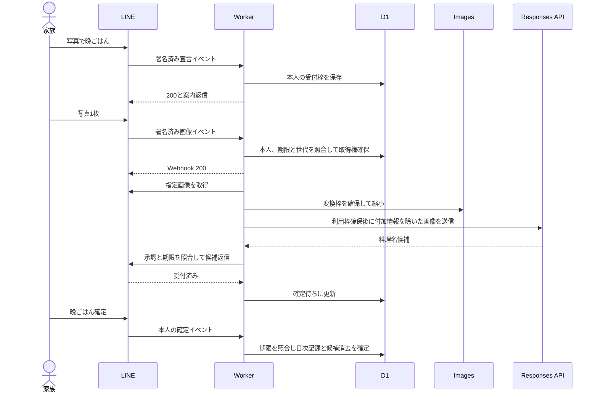
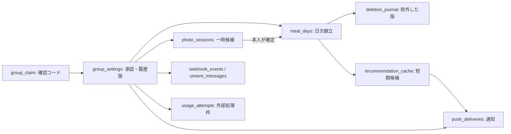

# LINE 晩ごはん Bot 詳細設計書

> 基本設計の14件の連携仕様を、実装と単体試験が参照できる15件の部品仕様に展開した。D1 の更新条件で同時登録・再送・取消を扱い、外部送信と AI の利用枠は処理を開始する前に確保する。写真は処理中のメモリに限定し、本人の確定を受けた料理名だけを履歴に登録する。

## 文書管理（必須）

| 記録項目 | 内容 |
| --- | --- |
| 文書版または更新日 | v1.1 · 2026-11-23 JST |
| 作成・更新者（該当時） | Codex |
| 関連資料・版の参照先（該当時） | [基本設計書 v1.0](basic-design.md)・[要件定義書 v1.1](requirements.md)・[調査報告書 v1.1](investigation.md) |

## 設計対象と参照資料（必須）

| 記録項目 | 内容 |
| --- | --- |
| 対象部品・機能 | Webhook、コマンド、献立・集計、AI 利用管理、写真受付・取得・正規化・認識、返信・定時配信、管理と保守。 |
| 設計範囲 | TypeScript の実装境界、D1 の論理スキーマ、処理順、外部入力、状態と同時実行、異常時、単体試験の期待結果。 |
| 対応する基本設計書の版・参照先 | [基本設計書 v1.1](basic-design.md) IF-01〜IF-14。 |
| 現行コード・設計の参照先（該当時） | 新規開発。対象フォルダに既存の Bot 実装・マイグレーションはない。 |
| 設計上の前提・制約（該当時） | 一家族・1グループ。日付は日本時間。外部入力を保存する範囲を限定。追加支出なしの条件を確認できるまで AI・写真・定時配信は無効。実環境の配備と実行は後続工程。 |

## 部品仕様（必須）

| 仕様 ID・項目名 | 対象部品 | 対応する基本設計 ID・参照先 | 責務・変更内容 |
| --- | --- | --- | --- |
| DD-01 Webhook | `src/webhook.ts` | IF-01 | 生バイトの署名、宛先、イベントの識別・ルーティング・受付。 |
| DD-02 コマンドと日付 | `src/commands.ts` | IF-01・IF-02・IF-06 | コマンドの区別、食事日・料理の入力検証。 |
| DD-03 献立の更新 | `src/meals.ts` | IF-02 | 日次登録・訂正・削除・送信取消、履歴更新番号。 |
| DD-04 履歴と集計 | `src/history.ts` | IF-03 | 一つの DB スナップショットから日数・料理の頻度・根拠を取得。 |
| DD-05 献立提案 | `src/recommendations.ts` | IF-04 | ルールで集計根拠を作り、AI または簡易案を選ぶ。 |
| DD-06 利用予約と OpenAI 接続 | `src/ai.ts` | IF-04・IF-05・IF-09 | 料金条件、呼び出し回数、Responses API の共通制御。 |
| DD-07 写真受付と確定 | `src/photo-session.ts` | IF-06 | 本人と写真投稿の対応、予約状態、確定と取消。 |
| DD-08 LINE 画像取得 | `src/line.ts` | IF-07 | 許可した添付データを固定ホストから上限内で取得。 |
| DD-09 写真正規化 | `src/photo-image.ts` | IF-08 | 画像変換の条件、縮小、メタデータの除去と最終検査。 |
| DD-10 料理名の認識 | `src/photo-recognition.ts` | IF-09 | 専用の構造化出力で候補または判別不能を返す。 |
| DD-11 LINE 応答 | `src/line.ts` | IF-10 | 1回限り・締切付きのグループ返信。 |
| DD-12 定時配信 | `src/scheduled.ts` | IF-11 | JST の送信窓、当日単位の通知、同じキーによる再試行。 |
| DD-13 LINE 残量照合 | `src/push-quota.ts` | IF-12 | 月上限・概算通数・人数と内部の予約を照合。 |
| DD-14 管理とグループ承認 | `src/group-access.ts`・運用コマンド | IF-13・IF-01 | 初回の確認コード、承認・停止、変更世代の管理。 |
| DD-15 保持と復旧 | `src/maintenance.ts`・運用コマンド | IF-14 | 期限処理、書き出し、取消を反映した復旧。 |

## 入出力と処理（必須）

| 仕様 ID・項目名 | 前提・入力 | 処理手順・判定分岐 | 使用データ | 出力・状態変化 |
| --- | --- | --- | --- | --- |
| DD-01 Webhook | `POST /line/webhook`、署名、ボディ、受信時刻 | パス・メソッド・サイズを検査 → HMAC を検証 → JSON・宛先を検証 → イベントを正規化。参加状態変更を先に扱い、次に取消、残りは発生時刻・イベント ID 順。各イベントで必要な DB 処理が確定した時点で返信・外部処理を `waitUntil` に登録する。 | LINE 宛先、グループ状態、イベント ID、時刻 | 正常は空の HTTP 200。個別トーク・雑談・未許可イベントは返信なし。書き込み前の重要な障害は503。複数イベントの再送では既に確定したイベントを再適用しない。 |
| DD-02 コマンドと日付 | テキスト、LINE 発生時刻、当日の JST 日付 | 長いコマンド名から正確に判定。全体を trim し、コマンド境界に半角・全角空白を認める。料理は `、` 区切りで順序維持。空品目・制御字・不正な日付を拒否。食事日を実日付と保持窓で検査。 | コマンド表、JST 日付 | `command`・`invalid`・`ignore` のいずれか。入力誤りは使い方を返信する。 |
| DD-03 献立の更新 | 操作種別、食事日、品目、元投稿の識別子、発生時刻 | イベントの一意性と承認世代を確かめ、元投稿の取消、現在の変更順、日次記録の有無を同じ処理で照合。登録と写真確定は当日未登録時、修正と削除は現行ありの場合だけ適用。更新時だけ履歴更新番号を進める。 | 献立日次、取消記録、受信イベント、グループ設定 | `created`・`updated`・`deleted`・`exists`・`missing`・`stale`・`duplicate`・`blocked`。 |
| DD-04 履歴と集計 | 承認済みグループ、基準日 | DB の一つの読み取りスナップショットで履歴版・現行記録を読む。7日分を日付昇順、30日分を料理ごとに集約。料理は同一日1回として、回数降順・最終日降順・正規化キー昇順で並べる。 | 献立の日付と品目、履歴更新番号 | 7日履歴、30日の日数と上位3品、最後に出た日、最近3暦日の主菜、履歴更新番号。 |
| DD-05 献立提案 | 対象日、現在の日付、現在の設定 | 対象日の前日を集計基準日とし、対象日・履歴版・承認世代が一致するキャッシュを確認。0件または AI 無効時は簡易案。AI 有効時は対象日で利用枠を予約し、根拠 ID を付けた集計を送る。AI 結果は候補数・料理名・重複・根拠を検証し、公開直前に版を再確認。 | 集計、利用予約、候補キャッシュ、固定献立表 | 対象日、候補2〜3行、補足1行。上限・不正出力・履歴更新時は最新の集計から簡易案を作り直す。 |
| DD-06 利用予約と OpenAI 接続 | 機能、食事日または提案対象日、JST 実行月、設定、期限、用途別入力 | 機能の有効化と課金確認期限を照合。DB で日次・月次を排他的に確保してから1回呼び出す。送信直前に承認・設定を再確認し、経過時間で中止。OpenAI の応答は用途別に検証する。 | AI 利用予約、独立した変換予約、課金設定 | 成功／判別不能／不正応答／上限／利用停止／失敗／結果不明。失敗・打切も利用枠を消費する。 |
| DD-07 写真受付と確定 | 本人の宣言・写真・確定・取消、LINE 写真の送信取消 | 宣言後の本人の次の画像1枚を条件付きで取得対象にする。候補を返信して LINE に受け付けられたら確定待ちへ。確定では候補または指定した置換料理を DD-03 に渡す。 | 受付状態、画像 ID、本人キー、承認世代、期限 | 未確定中は履歴変更なし。確定時のみ1件を登録。取消・期限切れ・同日先行登録で終了し、写真状態の参照を遮断する。 |
| DD-08 LINE 画像取得 | 選択済み・`contentProvider.type=line` の画像 ID | 固定の `api-data.line.me` を Bearer 付きで1回取得。宣言されている長さと実際の読み取り長の両方を検査。JPEG／PNG の MIME とシグネチャが一致する場合だけ次へ渡す。 | LINE トークン、画像 ID。本文はメモリ内。 | 画像のバイト列、または取得不可／未対応／サイズ超過。 |
| DD-09 写真正規化 | 許可された画像バイト、Images Free の利用確認 | 画像の形式・寸法・単一画像を検査 → 変換枠を予約 → バインディングで長辺1024 px 以下の JPEG を生成 → 付加領域を除去し、構造とサイズを検査。 | 変換予約、元画像と処理後の JPEG（メモリ内） | 付加情報を含まない JPEG。検査を満たせない場合は破棄し、OpenAI へ送信しない。 |
| DD-10 料理名の認識 | 正規化 JPEG、本人の処理中状態 | 固定指示と `input_image` に1枚だけを渡す。料理名が読める場合は `ok`、分類できない場合は `uncertain`。候補の長さを検証し、取消・期限・承認世代を照合して返信。 | 正規化 JPEG、AI 予約、写真受付状態 | 候補1〜5品、またはテキスト記録の案内。結果から自動保存しない。 |
| DD-11 LINE 応答 | 応答トークン、承認世代、期限、表示内容 | 送信直前に承認と締切、返信権を照合。返信権を原子的に消費し、固定 LINE ホストへ text message 1件を送る。 | 受信イベント、応答トークン（メモリのみ） | 2xx で受付。異常時は結果分類だけを記録。再送や代替プッシュは行わない。 |
| DD-12 定時配信 | UTC Cron、通知設定、現在時刻 | JST の送信窓を判定 → 対象日の候補 → DD-13 → 同日1行と UUID、固定本文、送信枠を確保 → 送信。再試行では設定・人数・履歴版と残量を再確認し、同一内容とキーを使う。 | 通知設定、送信予約、候補、履歴更新番号 | 受付成功／再試行待ち／最終失敗／見送り。LINE 受付後は同日分を再確保しない。 |
| DD-13 LINE 残量照合 | 専用アカウント、月、LINE の上限・概算通数・人数 | 最大200通で上限を切る。LINE 概算通数と内部確定数の大きい方を計上し、結果不明の内部予約も引く。返信にプッシュ枠は予約しない。 | LINE API の照会結果、送信予約 | `allow`・`insufficient`・`unknown`。同一通知の再試行では自分の枠を二重計上しない。 |
| DD-14 管理とグループ承認 | 環境別の運用権限、LINE 管理者 ID、確認コード | Cloudflare 認証済み手順でコードを発行。署名済みで本人コードが一致したグループを候補として保存。管理者が照合して有効化。参加・退出や設定停止で承認世代を進める。 | 設定、候補、承認世代、運用ログ | 候補／有効／一時停止／退出。未承認時は記録・取得・送信なし。 |
| DD-15 保持と復旧 | Cron の時刻、管理者操作、復旧対象と削除照合情報 | 毎日の期限処理と短期限の候補整理を実行。書き出しは料理名・食事日だけ。復旧時は運用を停止し、旧データの版・削除情報・期限を確認してから再接続する。 | 日次記録、取消と削除、候補、通知予約 | 365暦日の有効記録だけを提供。履歴・許可の安全性が確認できない復旧は隔離する。 |

## 境界値・異常時の挙動（補足）

| 仕様 ID・項目名 | 境界・異常条件 | 期待する結果・エラー | 副作用・データの扱い | 回復方法（該当時） |
| --- | --- | --- | --- | --- |
| DD-01 Webhook | パス違い／メソッド違い／署名不正／JSON 不正／異なる宛先／512 KiB 超 | 404／405／401／400／400／413。署名前に JSON を解釈しない。正規の空イベントは200。 | DB と外部サービスを呼ばない。未対応のイベント種別のみ無視。 | LINE 設定の修正。 |
| DD-02 コマンドと日付 | 空・121文字・正しくないうるう日・明日・当日から365日前 | 記録せず入力例を出す。1〜120 Unicode コードポイントの献立文字列、当日から364日前まで有効。 | 無関係な文章は無応答。有効な操作と範囲外を混同しない。 | 料理や日付を指定し直す。 |
| DD-03 献立の更新 | 同日2件、取消が先着、現行版と古い版、削除後に古いイベントが到着 | 日次1件。先着取消済みは作らない。古い版への取消と古い更新は無変更。 | 変更の有無とイベント処理の状態を一貫して保存。 | 正しい操作を新規投稿。 |
| DD-04 履歴と集計 | 0日、欠測、同日重複品目、修正・削除、同数 | 正確な日数、同日は1回。空なら「まだ記録なし」。DB 例外は空結果にしない。 | キャッシュは現在の履歴版で照合する。 | 取得失敗時は再入力を案内。 |
| DD-05 献立提案 | 0・1〜6・7日以上の履歴、今日と明日の対象日、日付変更、AI の根拠 ID 不一致、生成中の履歴変更 | 0日は一般案、1〜6日は件数を明示。十分な履歴では少なくとも一つ実データ根拠を表示。不正・旧版は簡易案。 | 履歴版・承認世代が変わったキャッシュや期限切れの結果は参照しない。 | 同じ対象日の有効な候補は、日付変更後も利用枠を消費せず再照会できる。 |
| DD-06 利用予約 | 31件から32件目、同日の並行実行、月またぎ、期限ちょうど、429・不明なネットワーク結果 | 機能ごとに31件まで。予約時 JST 月で集計し、同一対象日を翌月に再予約しない。利用期限ちょうどで停止。残高枯渇・認証／課金異常は AI を停止。 | 実行済みか不明でも利用予約を消さない。一時レート制限からは当日再試行しない。 | 簡易案・テキスト入力。課金停止からは管理者が再承認。 |
| DD-07 写真受付と確定 | 宣言からちょうど5分、写真候補からちょうど10分、別人、取消中に成功結果、日付またぎ | 期限は上端を含まない。確定者は本人のみ。中断された候補は確定不能。食事日は写真の JST 投稿日。 | 事前宣言なし・別人の画像は画像取得0件。旧結果で状態を復活させない。 | 新しい指定、またはテキスト記録。 |
| DD-08・DD-09 画像 | 5,000,000バイト超、MIME 不一致、切断、多重画像、画像の変換失敗 | 取得または変換を中止。JPEG／PNG だけ扱う。最終 JPEG の検証に失敗した場合は送信しない。 | 画像本文・エラー時の添付をログに記録しない。 | テキスト記録。 |
| DD-10 料理名の認識 | 複数の出力、拒否、不完全、非料理画像、空の `ok`、期限切れ | 応答を候補として採用しない。`uncertain` と同じ案内。 | 空や無効な候補を保存しない。 | テキストで確定した料理名を入力。 |
| DD-11 LINE 応答 | 期限ちょうど、二重消費、非2xx、タイムアウト | 外部送信なし、または送信済みの1回で終了。受付済みの予定をプッシュに変更しない。 | 既に確定した献立は残す。 | 履歴で確認、必要なら本人が再投稿。 |
| DD-12 定時配信 | 通知停止、予定時刻＋15分、LINE の再試行キー既受付、人数や履歴変更 | 窓外は送信なし。既受付を示す409は完了扱い。変更済みなら固定内容の再試行を見送る。 | 結果不明の予約を枠から解放しない。 | 手動で提案を取得可能。 |
| DD-13 LINE 残量照合 | 消費0、残量＝人数、残量＜人数、人数0、不正応答 | 消費0は有効。残量＝人数なら許可、足りなければ見送り。人数0・不明は送らない。 | 見送り理由のみ記録。 | 管理者が LINE の契約・通数・人数を確認。 |
| DD-14 管理 | 未許可グループ、確認コード再使用、参加イベント遅延、退出後の再招待 | 照合失敗時は登録しない。参加者変更で処理を停止し、退出後は明示承認まで停止を維持。 | 古い処理が承認世代をまたいで確定・送信されるのを防ぐ。 | 管理者がグループを照合し、再承認。 |
| DD-15 保持と復旧 | 期限切れ、バックアップ内の旧版、削除照合情報の欠落 | 稼働データに含めない。照合できない旧版は復旧対象外。 | 写真・LINE トークン・通知途中状態を復旧しない。 | 照合できる資料でやり直すか、空の履歴で再開。 |

## データ構造（補足）

D1 の列型は `TEXT` と `INTEGER` を基本とする。日付は `YYYY-MM-DD`、月は `YYYY-MM`、瞬間は UTC の Unix ミリ秒、JSON は妥当性を検査した UTF-8 テキスト。以下のテーブル名・列名は実装時の契約とする。省略が明記された列以外は NOT NULL。

| データ項目・構造 | 型・形式 | キー・制約・既定値 | 参照・更新規則 | 仕様 ID・参照先 |
| --- | --- | --- | --- | --- |
| `group_settings` | `singleton`、`group_id`、`status`、`epoch`、`history_rev`、`approved_at_ms`、`suggestions_enabled`、`photos_enabled`、`push_enabled`、`push_minute_jst`、`ai_valid_until_ms`、`images_valid_until_ms`、`ai_hold_code`、`last_membership_ms`、`updated_at_ms` | PK `singleton=1`、`group_id` は登録前 NULL。状態 `unbound/candidate/active/paused/left`。世代・履歴版0、各フラグ0、時刻1260分。承認時刻・確認期限・停止分類・最終メンバー変更は初期 NULL。 | 管理・参加変更で世代を進める。許可・停止はフェンスに使う。承認時刻より前の未処理の通常操作は適用しない。献立の確定済み変更だけが履歴更新番号を進める。 | DD-01・DD-03・DD-14 |
| `group_claim` | 確認コードのハッシュ、管理者キー、期限、候補グループ ID、使用時刻 | 同時に1件。候補 ID と使用時刻は照合成立前 NULL。 | 10分、一度限り。コードの値は DB・ログに保存しない。候補から有効化は別の管理操作。 | DD-14 |
| `meal_days` | `group_id`、`meal_date`、`dishes_json`、`version`、`event_time_ms`、`event_key`、`source_key`、`photo_key`、`updated_at_ms` | PK `(group_id,meal_date)`。料理は順序付きの空でない配列。削除後は料理・元投稿のキーを NULL にし、版と最終更新順を残す。写真キーは写真由来だけ。 | 修正は版を進め、取消は現行版の元投稿にだけ反映。削除済み行は検索・集計から除外し、競合判定まで存置。元投稿の照合列に索引。 | DD-03・DD-04・DD-15 |
| `webhook_events` | `event_key`、`group_id`、`status`、`reply_used`、`expires_at_ms`、`execution_id` | PK イベントキー。処理結果は分類のみ、返信権の初期値0。受付から7日で失効。 | 操作適用とイベント行を同じ DB 処理で確定。最初に取得した実行だけ外部処理を起動できる。本文は保存しない。 | DD-01・DD-03・DD-11 |
| `unsent_messages` | `group_id`、`message_key`、`event_time_ms`、`expires_at_ms` | PK `(group_id,message_key)`。7日。 | 取消先着の照合と、写真受付中・現行版の取消に使用。既存記録の取消は古いイベントでも受け付ける。 | DD-03・DD-07 |
| `photo_sessions` | `group_id`、`actor_key`、`session_id`、`epoch`、`state`、`declared_at_ms`、`ready_at_ms`、`deadline_ms`、`photo_key`、`meal_date`、`candidate_json` | PK `(group_id,actor_key)`、セッション ID は UUID。写真取得前の写真キー・食事日、結果前の候補、確定待ち前の返信受付時刻は NULL。 | 確定・取消・失効で候補を消去。画像バイトと外部 URL は保存しない。古い非同期結果はセッション ID・状態・世代で拒否。 | DD-07・DD-10 |
| `usage_attempts` | `kind`、`group_id`、`target_key`、`month_jst`、`execution_id`、`status`、`created_at_ms` | PK `(kind,group_id,target_key)`。種別 `recommendation/photo_ai/image_transform`。状態 `reserved/succeeded/failed/unknown`。月・種別で索引。月31件／種別。 | 提案・認識の対象キーは指定の日付。変換は元画像のキー。予約は一度だけ。通信失敗も件数として残し90日で削除。 | DD-06・DD-09 |
| `recommendation_cache` | `group_id`、`target_date`、`history_rev`、`epoch`、検証済み候補 JSON、`expires_at_ms` | PK `(group_id,target_date)`。対象日の JST 終了まで有効。対象日開始を期限として保存した既存行にも同じ有効範囲を適用する。 | AI 成功だけを短期保存。履歴・承認世代・設定の変更で参照対象外とする。次の Cron で無効行を消す。 | DD-05・DD-12 |
| `push_deliveries` | `group_id`、`target_date`、`billing_month_jst`、`epoch`、`history_rev`、`state`、`retry_key`、`body_json`、`reserved_count`、`attempt_count`、`attempt_owner`、`lease_until_ms`、`deadline_ms`、`last_result` | PK `(group_id,target_date)`、キーは UUID で一意。送信前の所有者・結果は NULL 可。送信枠は非負。 | ペイロードは同キーの再試行だけに使い、完了または締切後に消す。状態と計上数は90日で失効。 | DD-12・DD-13 |
| `deletion_journal` | `group_id`、`meal_date`、`max_removed_version`、`recorded_at_ms` | PK `(group_id,meal_date)`。削除や差し替えで除外した版の最大値。 | 献立更新と同時に記録し、対象バックアップがすべて失効するまで保持。復旧照合用。料理本文は含まない。 | DD-03・DD-15 |

イベント・本人・投稿を照合するキーは、環境別の `EVENT_KEY_SECRET` を使った種別・グループ別の HMAC-SHA256 とする。管理者 ID と許可グループ ID に限り API 呼び出し・照合に必要な値を環境設定または D1 に保持する。この鍵のローテーション時は運用を停止し、既存の取消照合が必要な期間は旧鍵も参照できるようにする。

## 状態遷移と同時実行（補足）

| 状態・イベント | 遷移条件 | 遷移先 | 実行する処理・副作用 | 並行実行時の扱い（該当時） |
| --- | --- | --- | --- | --- |
| グループ `unbound → candidate → active` | 本人の期限内コード → 管理者の明示承認 | 承認済み | 承認前の料理・画像・返信を処理しない。 | コードを一度だけ消費。候補 ID を承認時に照合。 |
| グループ `active` ＋メンバー変更／退出 | 対象グループの未適用イベント | `paused`／`left` | 世代を進め、既存の写真セッションと外部処理を無効化。退出からの再開は再設定と承認。 | グループ状態を更新した後に、イベント処理と送信の各直前で世代を再照合。外部受付済みの送信は取り消せない。 |
| 写真 `なし → awaiting` | 本人のコマンド、写真有効かつ課金・変換条件内 | 受付待ち | 5分の期限を設定し、外部処理の説明を返信。 | 同一本人の有効なセッションは一つ。受付中に再度同じコマンドを受けた場合は既存の案内・期限を返す。 |
| 写真 `awaiting` ＋画像 | 本人、宣言後の時刻、受付期限内、画像未取消 | `processing` | セッションに画像キーと食事日をひも付ける。 | 該当行の条件付き更新に成功した実行だけ取得・変換に進む。 |
| 写真 `processing` ＋結果 | 候補が有効で、セッションと世代が一致 | `reply_pending → ready` | 候補を一時保存。返信が LINE に受け付けられた時刻から10分で失効。 | 受付中に届いた取消は状態を優先終了。返信が失敗・不明の場合は確定待ちにしない。 |
| 写真 `ready` ＋本人の確定 | 同一セッションと世代、確定操作の発生時刻が候補の返信受付以降、処理時点も確定期限内、同日未登録 | 終了 | DD-03 で1件を作り、候補を消す。既存記録があれば上書きせず修正コマンドを案内。 | 確定と日次作成を同じ DB 処理に含める。新しい候補の提示前に発生した確定操作を適用しない。 |
| 写真の待機・処理・確定待ち ＋取消／失効／外部失敗 | 対象本人または元画像の取消、機能停止、期限到来 | 終了 | 候補を消し、以後の確定を拒否。失敗は可能な範囲でテキスト案内。 | セッション ID が一致しても終了済みの結果は状態に反映しない。既に外部送信された写真は回収できない。 |
| プッシュ `なし → in_flight → accepted` | 送信窓内、枠と承認の条件成立、LINE 2xx または既受付の409 | 受付済み | 送信ごとのキーと使用枠を保存し、以後は配信しない。 | 一意行を確保し、送信実行の所有者を条件付きで更新。古い応答では最新状態を上書きしない。 |
| プッシュ `in_flight/retryable → in_flight/stopped` | 5xx・結果不明・所有期限切れ、締切内、履歴と世代一致 | 再試行または終了 | 同一キー・同一本文で1回目を含め最大3回。枠不足・不正設定・その他の4xx・締切で停止。 | 30秒の所有期限、1送信の通信期限5秒。所有権を取れなかった Cron は外部送信0。 |

### 更新順と期限の根拠

- **イベントの確定。** D1 の `batch()` を使い、イベント行の挿入・変更条件を満たす献立更新・履歴版の上昇・結果分類を一括で処理する。イベント行に初回の実行 UUID を入れ、後続の書き込みはその UUID を所有する場合だけ行う。イベント重複は変更も返信も起動しない。一括失敗は503で再送可能にし、DB 確定後の外部障害は受信自体の再処理に戻さない。 [D1 Database API](https://developers.cloudflare.com/d1/worker-api/d1-database/)
- **同日競合。** 登録は1日1行の条件付き作成。訂正・削除の順は LINE 発生ミリ秒、同時刻ならイベントキー順。削除後も最後の変更順を残す。写真確定は料理の日付に画像の時刻、変更順に確定操作の時刻を使う。元画像または確定投稿の取消は、現行の `source_key`／`photo_key` に一致するときだけ削除する。
- **時計。** 行の期限はすべて上端を含まない。事前宣言と写真の対応は LINE の発生時刻で判定し、処理時点でも期限内であることを確認する。候補確定は LINE の返信受付時刻から10分以内。7日以上遅れた通常操作と将来5分を超える時刻の通常操作は無視する。メンバー変更と現行版の取消は古さだけでは拒否しない。

## 詳細設計図（補足）

| シーケンス図・状態遷移図・ER 図 | 対象の仕様・データ | 参照先 |
| --- | --- | --- |
| シーケンス図 | 写真受付、外部呼び出しの順、確定時の D1。 | 下図、DD-07〜DD-11 |
| 状態遷移 | 写真受付、グループ承認、プッシュの再試行。 | 上の状態遷移表 |
| データ関連図 | 承認グループをキーとする主要データと状態の関係。 | 下図、データ構造表 |

## 設計判断と未確認事項（補足）

| 項目 | 設計判断・未確認内容 | 根拠・影響 | 課題 ID・参照先 |
| --- | --- | --- | --- |
| DB と再送 | D1 の一括トランザクションと行の条件付き更新を採用。照合に必要な状態は同じプライマリの読み取りで確かめる。 | 更新失敗時に履歴だけ確定する状態を避ける。D1 本番での並行試験は後続。 | DD-01・DD-03・DD-06・DD-12、[D1 Database API](https://developers.cloudflare.com/d1/worker-api/d1-database/) |
| 画像処理 | Images binding で画素処理、Worker で最終出力を検査。サイズ・メタデータ検査に失敗したら処理を停止する。 | 無料プラン適用、Worker CPU、画像品質、スマートフォン実機での JPEG／PNG 受信、20秒の処理枠は未計測。 | DD-08〜DD-10、AC-18・AC-20、[Images binding](https://developers.cloudflare.com/images/optimization/binding/) |
| AI の実費と利用権限 | GPT-6 Luna を初期モデルとする。OpenAI Platform の専用プロジェクトキーを環境ごとに設定する。 | 対象組織の付与クレジット、請求経路、実際のモデル権限と画像トークン量は未確認。両 AI 機能は条件確認まで無効。 | Q-001、DD-06・DD-10、[モデル仕様](https://developers.openai.com/api/docs/models/gpt-6-luna)・[クレジット条件](https://developers.openai.com/api/docs/guides/chatgpt-api-credits) |
| 定時通知 | 5分刻みの設定と15分窓で運用し、既受付か不明な送信は予約通数を保守的に確保する。 | グループ人数・実際の通数の差分と、クォータ API の応答はテスト用 LINE アカウントで照合する。 | DD-12・DD-13、AC-11・AC-12 |

## 関数・API・入力検証（補足）

| 仕様 ID・入口 | 引数・型・入力制約 | 検証順序・既定値 | 戻り値・エラー | 呼び出し元・参照先 |
| --- | --- | --- | --- | --- |
| DD-01 `handleWebhook` | Request、環境、実行コンテキスト、注入可能な時計 | 未加工のバイトを Web Crypto で署名検証。署名は Base64 の正しい HMAC 長。JSON の `destination`、`events`、既知イベントの型・時刻・ID を検査。 | HTTP Response。受信 JSON や署名値をログなし。 | Worker `fetch` |
| DD-02 `parseCommand` | UTF-8 テキスト、投稿時刻、現在日 | 全体の前後空白だけ除去。プレフィックスの後ろが空白か末尾の場合だけコマンド。日付文字列の見た目と暦を別々に検査。 | 識別されたコマンド、入力エラー、無視。 | DD-01 |
| DD-03 `applyMealChange` | グループ・承認世代、イベント、日付、操作、品目、元キー | 有効な食事日 → イベント確保 → 取消照合 → 保存条件 → 更新版。取消だけは承認停止中も対象グループの既存記録を保護するため実行。 | 変更結果と新しい履歴版。 | DD-01・DD-07 |
| DD-04 `readHistory`／DD-05 `recommend` | グループ、JST の集計基準日または提案の対象日、時計 | 期限と履歴版を確認し、テキスト入力は集計から生成。AI 結果は根拠 ID、品目、件数を照合。 | 画面表示用の履歴／集計／候補、または取得失敗。 | テキスト操作・Cron |
| DD-06 `reserveUsage`／`requestResponse` | 用途、対象キー、月、承認世代、締切、上限付き入力 | 予約を取った処理だけ送信可。両用途とも Responses の `store:false`、`tools:[]`、`reasoning.effort:none`、`text.format` の厳密 JSON Schema。 | 完了済み1件の出力、または失敗分類。 | DD-05・DD-09・DD-10 |
| DD-07 `advancePhotoSession` | イベント種類、本人キー、時刻、候補、世代 | 参加と機能を照合 → セッション ID と期限 → 期待状態で条件付き更新。既登録日の写真は取得前に案内し、確定直前も再確認。 | 無応答／案内／認識の開始権／確定結果。 | DD-01・DD-10・DD-11 |
| DD-08 `getImage`／DD-09 `normalizePhoto` | LINE 画像 ID、締切、画像バイトまたは取得失敗 | 固定の LINE ホストからリダイレクトなしで取得。変換前に JPEG／PNG の寸法・最大16メガピクセル・長辺8192 px 以下を検査。変換後の JPEG は長辺1024 px・256 KiB 以下。 | 正規化 JPEG、または失敗。元バイトをログ・DB に渡さない。 | DD-07 |
| DD-10 `recognizeDishes` | 正規化画像、処理中状態、締切 | 専用の構造化出力は `status` と `dishes` の2項目だけ。 `ok` では1〜5品、合計120文字まで。 `uncertain` では空配列。 | 検証済みの候補か判別不能。 | DD-07・DD-06 |
| DD-11 `sendReply` | イベントキー、トークン、承認世代、締切、文面 | 元投稿の取消・最新の承認状態・時刻を照合し、返信権を消費。通信上限は3秒か実行残り時間の短い方。 | 受付／拒否／結果不明／抑止。 | DD-01・DD-05・DD-07 |
| DD-12 `runSchedule`／DD-13 `checkPushQuota` | 予定時刻、現在時刻、設定、LINE の3照会、DB 状態 | 通知窓内のみ。照会は各3秒まで、要求直前に有効な照会結果と所有権を確認。予約から送信までに分が変わった場合は締切も再確認。 | 通知送信・見送り理由。 | Worker `scheduled` |
| DD-14 `claimGroup`／管理コマンド | LINE 管理者 ID、期限付きコード、認証済み管理経路 | 確認コードは暗号学的乱数128ビット以上で、期限と本人を照合。承認・停止は Cloudflare 管理者経路から実行。 | 候補、承認結果、停止結果。 | DD-01・運用 |
| DD-15 `purgeExpired`／管理コマンド | JST 判定日、復旧時の台帳、権限付きエクスポート | 集計の提供時も期限を照合。復旧では対象グループ、バックアップ日時、最大削除版、終了状態を先に検証。 | 期限処理数、書き出し、復旧可否。 | Worker `scheduled`・運用 |

### コマンドと候補の詳細

- **入力。** `晩ごはん <料理>`、`晩ごはん YYYY-MM-DD <料理>`、`晩ごはん修正 YYYY-MM-DD <料理>`、`晩ごはん削除 YYYY-MM-DD`、`献立履歴`、`献立傾向`、`今日の献立`、`明日の献立`、`写真で晩ごはん`、`晩ごはん確定 [料理]`、`晩ごはん取消`。日付指定のない記録は投稿の JST 日付を使用。日付指定は先頭引数が日付形式の場合だけ使う。日付指定の入力で日付部分に対する暦検証が失敗した場合は料理名に読み替えない。余計な引数を許さないコマンドは使い方を返信する。料理の正規化は比較用に NFKC・空白正規化・大小文字の統一を適用し、表示名には元の品目を使う。
- **簡易案。** あらかじめ用意する主菜・副菜の12組から、直近3暦日の主菜を外し、候補の主菜について30日出現回数の少ない順・最後に登場した日の古い順・固定順で並べ、最大3件を出す。2件に満たない場合のみ直近主菜を戻す。根拠の文面は「直近3日の主菜と重ならない」「直近30日で○回」などの確認済み事実から作る。7日分以上ある場合は、集計に実在する上位の料理と回数も理由に添える。0日分では固定順の一般案にする。
- **簡易案の固定順。** さばの塩焼き／冷ややっこ、鶏の照り焼き／温野菜、豚しゃぶ／わかめスープ、麻婆豆腐／青菜のおひたし、鮭のホイル焼き／きのこのみそ汁、親子丼／きゅうりの浅漬け、豚の生姜焼き／千切りキャベツ、野菜カレー／グリーンサラダ、鶏と大根の煮物／小松菜のごま和え、焼きうどん／豆腐のみそ汁、肉じゃが／トマトサラダ、厚揚げと野菜の炒め物／卵スープ。
- **OpenAI の献立提案。** 固定の指示文、集計基準日、対象日、利用できる記録日数、直近の主菜、出現回数・最後の出現日を根拠 ID 付きで送る。可変の JSON 入力上限は4,096 UTF-8 バイト。最近の主菜と上位根拠を優先し、根拠行単位で切り詰める。個人識別情報を認識した品目は送信しない。出力は候補配列のみで、各候補は `main`、任意を表す NULL を許す `side`、参照した `reason_ids`。品目は各60文字以内。主菜正規化後の重複・根拠不一致・候補数過不足は簡易案。7日分以上なら有効な履歴根拠が少なくとも1件必要。Bot は検証した根拠のうち1件を最後の補足に使う。
- **OpenAI の写真認識。** 検査済み JPEG から1要素の Base64 データ URL を作り、画像の `detail` は `low` を初期値とする。画像から見える料理名以外を出さない固定指示を送り、画像に文字の指示が含まれていても命令として扱わない。提案と認識の出力上限はそれぞれ512・256トークン。上限超過等の不完全な出力、拒否、複数のメッセージは失敗扱い。画像トークンは実測し、実費と画質を確認してから本番を有効にする。 [Responses API](https://developers.openai.com/api/reference/resources/responses/methods/create)・[画像入力](https://developers.openai.com/api/docs/guides/images-vision)
- **画像の付加情報。** 変換後 JPEG から APP 系セグメントとコメントを除去し、色向きの処理を含む変換の結果を確認する。最終出力にメタデータを持つ領域・画像末尾以降の付加データ・不正な長さがないことを検査する。除去・検査ができない形式はテキスト入力に切り替える。保持を保証できない LINE の元添付は画像イベントの処理中だけ取得する。 [LINE Get content](https://developers.line.biz/en/reference/messaging-api/nojs#get-content)

## 永続化・更新の整合性（補足）

| 対象データ・仕様 ID | 更新条件・順序 | トランザクション・排他 | 再実行・競合時の挙動 | 失敗時の復旧・確認方法 |
| --- | --- | --- | --- | --- |
| 献立・履歴版 DD-03 | イベント確保 → 承認と変更順 → 日次作成／更新／削除 → 除外版の記録 → 履歴版上昇 → 結果確定。 | 一括書き込み内で所有・状態・条件を検証。実際に変更した場合だけ版を進める。 | 同日作成競合は先着を保持。更新の遅延・取消先着を再評価。 | 承認中の保存前失敗は503。保存済みは表示失敗でも維持。 |
| 写真状態 DD-07 | 写真対象確保 → 画像処理 → 候補の返信 → 受付成功時に確定待ち → 本人が確定 → 献立更新と候補消去。 | 各状態更新はセッション ID・承認世代・期待状態・期限を条件にする。確定と献立変更は同じ一括処理。 | 取消・期限切れによって後着の認識結果を無効化。本人が旧セッションの候補を誤確定しないよう、有効セッションは同時に一つ。 | 返信の受付結果が不明なら候補を確定可能にしない。 |
| 外部処理予約 DD-06・DD-09 | 予約月の件数・対象キーの一意性・機能有効を条件とした INSERT → 予約所有を再確認 → 外部呼び出し → 結果。 | 日次と月次は1回の条件付き DB 処理。前回状態を読んでから無条件に書く処理は禁止。 | 同日に再実行しない。モデル呼び出しの上限は提案と認識で独立。変換は別枠。 | 外部送信直前の停止・失敗でも、取得済みの予約は戻さない。 |
| 通知と予約 DD-12・DD-13 | 初回は人数・上限・消費・履歴版を取得 → 送信枠と内容・キーを確保 → 外部送信。再試行は最新状態を再判定。 | DB の同時予約を差し引いて所有を取得する。送信結果は実行の所有者が一致する行だけ更新。 | 残量は `min(200,LINE上限) - max(LINE概算,内部確定数) - 未解決予約`。再試行では自分の予約を最後の項から外し、現在人数が予約数以下で残量が予約数以上の場合に限る。 | 5xx・タイムアウトのみ再試行対象。受付不明の予約は少なくとも対象月内で保持。 |
| 復旧 DD-15 | 非公開にする → 現行の削除照合情報を退避 → 旧データを照合 → 除外版・期限外を落とす → 承認世代と機能設定を確認 → 再接続。 | ライブ DB の Time Travel を使う場合は受付・配信停止を先に行う。可能なら隔離した DB で復旧候補を作り、検証後に切り替える。 | 運用用の復旧データは日付・版・取消照合情報を保つ。閲覧用 CSV に識別子と復旧に必要な版は含めない。 | 最新の削除情報を照合できない候補は接続せず、確実な版か空の履歴で再開。 |

## 画面・外部サービスの処理詳細（補足）

| 対象・仕様 ID | 入力・イベント | 表示や送受信への変換 | 異常・代替応答 | 関連する設計・図 |
| --- | --- | --- | --- | --- |
| LINE の記録 DD-02・DD-03・DD-11 | テキスト／保存結果 | 正常は記録日と献立。削除は日付と結果。返信は用途につき1通の text message。 | 既存日には修正方法を案内。通常会話と対象外の画像は無応答。 | IF-02・IF-10 |
| LINE の写真 DD-07〜DD-11 | 宣言、画像、候補、本人の確認 | 本人の宣言で、指定写真の OpenAI 送信を説明。候補は食事日、料理名、確定・訂正付き確定・取消を案内。 | 「写真から料理名を読み取れなかったよ。『晩ごはん 料理名』で記録できるよ。」条件未確認時は画像取得前にテキスト操作へ案内。 | 写真シーケンス図 |
| LINE の提案 DD-05・DD-11・DD-12 | 対象日、候補2〜3件、理由 | 対象日と各候補を1通に表示。簡易案はその旨を明記。 | LINE の返信が不成立でもプッシュしない。定時配信は有効化・残量の確認時のみ。 | IF-04・IF-10〜IF-12 |
| 外部 API DD-06・DD-08〜DD-13 | 固定 URL、専用認証、構造化入力・応答 | LINE と OpenAI の認証ヘッダーを別々に付ける。写真本体・識別子を利用目的外の API に転送しない。 | 外部のエラーボディは LINE とログに出さず、アプリ内分類に変換。 | IF-04・IF-07〜IF-12 |

## 設定・ログ・運用条件（補足）

| 設定や観測項目 | 初期値・適用条件 | 出力・記録内容 | 障害時の判定・対応 | 検証参照先（該当時） |
| --- | --- | --- | --- | --- |
| Worker と秘密情報 | 環境別の `DB`・`IMAGES`、`LINE_CHANNEL_SECRET`、`LINE_CHANNEL_ACCESS_TOKEN`、`LINE_BOT_USER_ID`、`LINE_ADMIN_USER_ID`、`EVENT_KEY_SECRET`、`OPENAI_API_KEY`。 | Secrets は環境ごとに投入し、コミット・ログ出力・共有を避ける。 | LINE 認証設定が不備なら Webhook の処理を拒否。AI／画像設定が不備なら該当機能のみ無効。 | DD-01・DD-06・DD-14 |
| 返信と外部処理の時間 | 受信から通常返信開始5秒以内、提案・写真返信開始30秒以内。AI 提案待ち15秒、写真全体20秒、返信開始の内部締切は受信から25秒。 | 操作分類、所要時間、結果、代替理由。 | Worker の残り実行時間が足りなければ処理を中止。AI の遅延後も返信余裕を確保する。 | DD-01・DD-05・DD-07・DD-11 |
| 定期実行 | UTC 5分周期。21:00 JST を通知時刻の初期案とし通知は無効。日次期限処理は03:00 JST、短期状態の整理は5分周期。 | 配信の有効・見送り・受付と通数、期限処理件数。 | 同一日次処理を再実行しても同じ結果にする。JST の日付変更後は遅れた通知を送らない。 | DD-12・DD-15 |
| AI と画像変換の制御 | `gpt-6-luna`。提案と写真は個別有効化。無料利用の確認有効期限を設定し、期限到来で停止。 | 機能、時刻、結果分類、利用回数、API から取得したトークン数の数値のみ。 | 認証異常・残高不足は AI を停止。Images の無料確認や認識結果の品質に問題がある場合は写真を停止。 | DD-06・DD-09・DD-10 |
| 保管とログ | 編集・削除を反映。D1 Free の Time Travel は7日。復旧用の暗号化バックアップは28日で失効。 | 本文・写真・返信トークン・識別子生値・鍵を監視ログに記録しない。運用状態の保持は最大90日。 | 最新の削除台帳、承認情報、利用枠を照合できるまで復旧環境を接続しない。 | DD-15、[D1 Time Travel](https://developers.cloudflare.com/d1/reference/time-travel/) |

## 単体試験への引き渡し

次の表は詳細設計上の判定基準。試験工程では DD ID を対象 ID として扱い、具体的な入力データと初回結果を試験書に記録する。

| 仕様 ID | 単体試験で与える条件 | 期待する結果 |
| --- | --- | --- |
| DD-01 | 有効・不正な署名、空イベント、DB 失敗、不許可グループ | 200／401／503などが契約どおり。署名不正から書き込み・送信は0。 |
| DD-02 | 月末・うるう年・JST 日付境界、空品目、120／121文字 | 有効な日付と品目だけ解釈し、日付指定を誤って料理名にしない。 |
| DD-03 | 初回2件競合、同一 ID 再送、取消先着と旧版取消 | 1日1件を維持し、旧版で現行履歴を巻き戻さない。 |
| DD-04 | 同日重複名、未記録日、集計窓外、削除と同率 | 件数・最終日・順序が入力から決定できる。 |
| DD-05 | 履歴0・6・7日、予約済み、根拠不正、履歴途中更新 | 理由が入力の根拠と整合。失敗・旧版は簡易案。 |
| DD-06 | 同日並行、2機能、31件目／32件目、月変更、残高エラー | 用途別に上限を守り、再課金せず、残高不足で停止。 |
| DD-07 | 他人の画像、5分・10分の境界、日付またぎ、処理中に取消、前の候補への確定イベントの遅延 | 指定した本人だけが確定でき、取消済み候補は復活しない。新しい候補の提示前に発生した確定は登録しない。 |
| DD-08 | 5 MB 境界、MIME 不一致、失効・タイムアウト | 許可された画像だけ取得。転送や自動再試行なし。 |
| DD-09 | EXIF 付き JPEG、PNG、異常セグメント、無料枠なし | 最終画像で付加領域が残らない。検証失敗では OpenAI 送信なし。 |
| DD-10 | 料理候補、判別不能、拒否、不正 JSON、空の成功 | 有効候補だけを一時保持し、ほかはテキスト案内。 |
| DD-11 | 締切・承認世代違い・競合・通信結果不明 | 返信は最大1試行。プッシュへ変更しない。 |
| DD-12 | JST 窓、既受付の409、結果不明、履歴変更 | 同日一件・同じキーと内容。条件変更時は再試行を見送る。 |
| DD-13 | 残量＝人数、未知、予約あり、再試行 | 余裕不足は送信0。自分の再送枠を二重計上しない。 |
| DD-14 | コード再使用、他人、所属変更、退出 | 管理者の明示承認だけが利用を開始でき、旧世代の処理は停止。 |
| DD-15 | 期限切れ、バックアップ復旧、照合情報欠落、取消済み | 有効な版だけが履歴に残り、写真や削除済みの旧版は戻さない。 |

## 変更・レビュー履歴（補足）

| 版・日付 | 変更理由・対象項目 | 確認内容・結果 | 差分やレビューの参照先（該当時） |
| --- | --- | --- | --- |
| v1.0 · 2026-11-22 | 本番の詳細設計を作成 | 基本設計の全14連携仕様を15件の部品仕様に対応づけ、各入力・状態・単体試験の判定基準を記載。 | [基本設計書](basic-design.md)・[要件定義書](requirements.md) |
| v1.1 · 2026-11-23 | DD-05 の対象日と返信を更新 | 対象日の前日を集計基準日とし、キャッシュの有効期間と既存行の扱いを記録。 | [基本設計書 IF-04](basic-design.md)・[標準テスト](../test/bot.test.ts) |
